 

 

## About

Full Stack Developer with **2+ years** of experience, strongest on the frontend with **React.js** and **Next.js**. I turn product ideas into fast, accessible and maintainable interfaces, and back them with clean Node.js APIs.

At **Deutics Global** I worked on **Camzify**, an AI-powered surveillance platform: I owned 20+ React components, integrated 15+ REST APIs with RTK Query and TanStack Query, and cut unnecessary re-renders by about 40% in production. Outside work I build and ship my own products, from an embeddable AI support chatbot to a multi-restaurant QR menu platform.

<table align="center">
  <tr>
    <td align="center" width="25%"><h2>2+</h2>Years of experience</td>
    <td align="center" width="25%"><h2>40%</h2>Fewer re-renders in production</td>
    <td align="center" width="25%"><h2>20+</h2>React components owned</td>
    <td align="center" width="25%"><h2>15+</h2>REST APIs integrated</td>
  </tr>
</table>

 

## What I Do

<table>
  <tr>
    <td width="33%" valign="top">
      <h4>Frontend Engineering</h4>
      Responsive React.js and Next.js apps with TypeScript, Tailwind CSS, Redux Toolkit and TanStack Query, tuned for performance with memoization, lazy loading and code splitting.
    </td>
    <td width="33%" valign="top">
      <h4>Backend and APIs</h4>
      REST APIs with Node.js, Express and MongoDB, including JWT authentication, protected routes and role-based access control.
    </td>
    <td width="33%" valign="top">
      <h4>AI and Integrations</h4>
      Products with Google Gemini and OpenRouter, Stripe payments, and transactional email with Resend.
    </td>
  </tr>
</table>

 

## Tech Stack

<b>FRONTEND</b> 

  

<b>BACKEND AND DATABASE</b> 

  

<b>TOOLS AND DEPLOYMENT</b> 

 

| | |
|---|---|
| **Frontend** | React.js, Next.js (App Router, SSR/SSG), JavaScript (ES6+), TypeScript, HTML5, CSS3 |
| **State and Data** | Redux Toolkit, RTK Query, TanStack Query, Context API |
| **Styling** | Tailwind CSS, Material UI, Styled Components, Bootstrap, Responsive Design |
| **Performance** | Memoization, Lazy Loading, Code Splitting, React Hooks |
| **Backend** | Node.js, Express.js, MongoDB, Mongoose, REST API Design |
| **Auth and Security** | JWT, bcrypt, Protected Routes, Role-Based Access Control |
| **AI and Integrations** | Google Gemini API, OpenRouter, Stripe, Resend, EmailJS |
| **Tools** | Git, GitHub, Vercel, Postman, VS Code, Figma |

 

## Featured Projects

<table>
  <tr>
    <td width="50%" valign="top">
      <h3>QR Digital Menu Platform</h3>
      Multi-restaurant digital menu with table ordering, bilingual support and WhatsApp ordering.  
      
        
      <a href="https://digital-menu-system-lime.vercel.app/">Live Demo</a> &nbsp;·&nbsp; <a href="https://github.com/sameerjohn1/digital-menu-system">Source</a>
    </td>
    <td width="50%" valign="top">
      <h3>AI Customer Support Chatbot</h3>
      Embeddable AI support chatbot with multi-organisation authentication, powered by Google Gemini.  
      
        
      <a href="https://ai-customer-support-six-ebon.vercel.app/">Live Demo</a> &nbsp;·&nbsp; <a href="https://github.com/sameerjohn1/Ai-Customer-Support">Source</a>
    </td>
  </tr>
  <tr>
    <td width="50%" valign="top">
      <h3>MERN E-commerce Store</h3>
      Full e-commerce flow with Stripe payments, an admin dashboard and an AI shopping assistant.  
      
        
      <a href="https://mern-ecommerce-store-liard.vercel.app/">Live Demo</a> &nbsp;·&nbsp; <a href="https://github.com/sameerjohn1/mern-ecommerce-store">Source</a>
    </td>
    <td width="50%" valign="top">
      <h3>Grocery Delivery Platform</h3>
      MERN grocery delivery application with Stripe checkout.  
      
        
      <a href="https://mern-grocery-delivery-platform.vercel.app/">Live Demo</a> &nbsp;·&nbsp; <a href="https://github.com/sameerjohn1/mern-grocery-delivery-platform">Source</a>
    </td>
  </tr>
  <tr>
    <td width="50%" valign="top">
      <h3>Schola — School Management SaaS</h3>
      Multi-tenant school management platform.  
      
        
      <a href="https://github.com/sameerjohn1/schola-school-management-saas">Source</a>
    </td>
    <td width="50%" valign="top">
      <h3>Social Media Automation</h3>
      Social media management tool with AI-generated content.  
      
        
      <a href="https://github.com/sameerjohn1/social-media-automation">Source</a>
    </td>
  </tr>
</table>

<a href="https://sameer-john-portfolio.vercel.app/"><b>See all projects in my portfolio →</b></a>

 

## Experience

**Backend Developer (MERN Stack)** · Freelance, Remote &nbsp;|&nbsp; *Sep 2026 – Nov 2026*
- Built the backend of a travel-planning platform from scratch with Node.js, Express and MongoDB Atlas, and agreed REST API contracts with the frontend developer.
- Implemented JWT authentication (register, login, protected /auth/me, logout) with bcrypt password hashing.
- Designed Mongoose schemas for User, Trip, Itinerary, Destination and Activity, and moved static frontend data into MongoDB with a custom seed script.
- Deployed the API on Vercel.

**Junior MERN Stack Developer (Contract)** · Sprouto Group, Lahore &nbsp;|&nbsp; *May 2026 – Jun 2026*
- Built transactional email with the Resend API on the Node.js/Express backend and connected it to the React.js frontend.
- Tightened protected-route handling so unauthorized users are properly blocked.
- Reduced bundle size with code splitting and more reusable components.

**Full Stack Developer** · Freelance, Remote &nbsp;|&nbsp; *Nov 2025 – Apr 2026*
- Shipped two projects on my own, both live on Vercel: an AI customer support chatbot (Next.js, Google Gemini, Scalekit) and a MERN expense tracker.
- Worked with the Next.js App Router, SSR/SSG, TypeScript, JWT flows and multi-organisation authentication.

**Associate Frontend Developer** · Deutics Global (Camzify), Lahore &nbsp;|&nbsp; *May 2024 – Oct 2025*
- Grew from Intern to Trainee to Associate on an AI-powered surveillance platform.
- Owned 20+ React components that are still live in production.
- Cut unnecessary re-renders by about 40% with memoization and better hook patterns.
- Integrated 15+ REST APIs using RTK Query and TanStack Query.

 

## GitHub Activity

 

## Open To

React.js Developer · Frontend Developer · Next.js Developer · MERN Stack Developer · Frontend-focused Full Stack Developer

Full-time or contract. Remote (open to candidates in Pakistan), or on-site / hybrid in Lahore.

 

## Let's Connect

